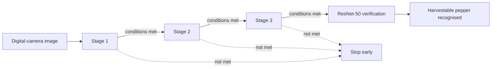

# Harvestable Black Pepper Recognition: an interactive explainer of a co-authored IEEE paper

[](https://creativecommons.org/licenses/by-nc-nd/4.0/)

## Overview

This repository is an unofficial, educational explainer of the paper *Harvestable Black Pepper Recognition Using Computer Vision* (S. Joseph, N. F. Jane Rose and P. V. Akhil, ICACC 2019, IEEE). It explains the idea of a staged image pipeline with a ResNet-50 verifier that separates harvestable pepper from leaves, branches and unripe berries, using only what the public abstract and the author's CV state, plus clearly labelled illustrative demos on synthetic images. **No code, data, images, figures or text from the paper are included, and the paper's code and data are not released.**

## Demo

Open `docs/index.html` in a browser (no build step, no network needed). No hosted demo exists; none has been deployed.


The page contains:

- the problem and what the public sources state, with a table of what is and is not public;
- a stage-by-stage walkthrough of the cascade, and a small cascade explorer;
- an interactive segmentation demo on generated synthetic images (HSV thresholds, morphological clean-up, blob-size filter, live masks);
- a conceptual "ResNet-50 as a verifier" panel based on the public ResNet architecture;
- the paper's reported result, shown only as "Reported in the paper (not reproduced here)";
- limitations, future scope, and sources and gaps.

Every illustrative element carries the label **"Illustrative example, not the paper's implementation"**.

## Problem statement

Black pepper is picked when berries on a spike reach the right stage of maturity, which is normally judged by eye. An automated harvester must first find harvestable spikes in a cluttered scene of leaves, trunks, branches and unripe berries. The paper's stated objective is to speed up that recognition for automated harvesting.

## Approach

What the public abstract and CV state about the paper:



- Three image-processing stages followed by a verification model.
- An image moves to the next stage only if pre-defined conditions are met, which the abstract says reduces processing time and computing resources.
- Several classifiers were tried by trial and error; ResNet-50 was chosen for the final validation.

**What the three stages actually do is not public.** The demo therefore does not claim to reproduce them. It illustrates generic, standard techniques on synthetic images: HSV colour thresholding, morphological opening and closing, and filtering blobs by area.

## Data

- The paper introduces a new black-pepper image set captured with a digital camera. **It is not included here and is not released.**
- The demo generates cartoon scenes in code (`generateScene` in `docs/js/imageproc.js`) from a numeric seed. They are original synthetic images, not derived from the paper's images.

## Results

| Metric | Value | Status | How measured | Date |
|---|---|---|---|---|
| Global accuracy | 100% | Reported (paper abstract, CV). Not reproduced here | Not stated in public sources | 2019 |
| Unit tests for the image-processing helpers | 24 of 24 pass | Verified (run 2026-10-14) | `node --test`, log in [docs/runs/2026-10-14-checks.md](docs/runs/2026-10-14-checks.md) | 2026-10-14 |
| Page console errors at 390 px and 1280 px | 0 | Verified (run 2026-10-14) | Playwright, see the same log | 2026-10-14 |

The demo displays no accuracy or other headline metric. It runs no recognition model.

## Tech stack

Plain HTML, CSS and JavaScript (no framework, no build, no CDN). Tests use Node's built-in `node:test`. Browser checks used Playwright.

## Getting started

Prerequisites: Node.js 20 or later (tested with v22.20.0). Python 3 is optional, only for a local web server.

```bash
git clone https://github.com/Janeferdinant/black-pepper-recognition.git
cd black-pepper-recognition
node --test
```

Expected output ends with `# tests 24`, `# pass 24`, `# fail 0`.

To view the page, open `docs/index.html` directly, or serve it:

```bash
python -m http.server 8000 --directory docs
```

then browse to `http://localhost:8000/`.

## Project structure

```
docs/index.html            the explainer page
docs/js/imageproc.js       HSV, thresholding, morphology, connected components, synthetic scene generator
docs/js/app.js             page behaviour (stepper, cascade explorer, demo, ResNet panel)
docs/runs/                 dated check logs and screenshots
tests/imageproc.test.js    node --test suite for the helpers
LICENSE                    CC BY-NC-ND 4.0
```

## Real-world applications

Selective harvesting of spice and fruit crops, yield monitoring, and ripeness grading are the settings where this kind of recognition is useful. The paper's own stated application is automated black-pepper harvesting.

## Limitations

- Single-crop image set (black pepper only).
- Capture conditions (lab or field, lighting) and test-set size are not stated in the public sources.
- A single reported global accuracy of 100%, without public detail on how it was measured.
- 2019 methods; today's detectors and segmentation models are more direct.
- No released data or code, so the paper's result cannot be re-run.
- The demos here use cartoon images and generic techniques; they do not test or approximate the paper's results.

## Future scope

These are suggestions of this explainer, not claims from the paper: modern one-stage or transformer detectors and instance segmentation; edge deployment with quantised models; evaluation across farms, seasons and lighting, with depth sensing; reporting precision, recall and confusion matrices on a shared benchmark.

## Sources and gaps

Sources used:

- Crossref record for DOI 10.1109/ICACC48162.2019.8986220 (title, authors, venue, pages, year).
- The public abstract, as indexed by Semantic Scholar from the IEEE record. The IEEE Xplore page itself returned no content to the automated fetch used here.
- The author's CV and portfolio card.
- He, Zhang, Ren and Sun, "Deep Residual Learning for Image Recognition", CVPR 2016, DOI 10.1109/CVPR.2016.90, for the standard ResNet-50 architecture.
- General reference summary of black-pepper harvest maturity: https://en.wikipedia.org/wiki/Black_pepper (background only, not from the paper).

Questions the public record cannot answer (the paper PDF would):

1. What does each of the three stages do, and what are the pass conditions between them?
2. What does the paper mean by "harvestable"?
3. Dataset size, class balance, splits, capture setting (lab or field) and lighting?
4. How was ResNet-50 used: trained from scratch or fine-tuned, input size, classes, decision rule?
5. How is "global accuracy" defined, and on how many test images?
6. What was the scan time, and on what hardware?

## Credits & citation

Paper: S. Joseph, N. F. Jane Rose and P. V. Akhil, "Harvestable Black Pepper Recognition Using Computer Vision," *2019 9th International Conference on Advances in Computing and Communication (ICACC)*, Kochi, India, IEEE, 2019, pp. 97-102. DOI: [10.1109/ICACC48162.2019.8986220](https://doi.org/10.1109/ICACC48162.2019.8986220).

Credit for the paper belongs to all three authors: Shelbi Joseph, N. F. Jane Rose (Jane Rose Ferdinant) and P. V. Akhil. This explainer is independent and is not affiliated with or endorsed by IEEE or the conference. The co-authors have not agreed to release the paper's code or data, so none is included.

## License

Original work © Jane Rose Ferdinant, licensed [CC BY-NC-ND 4.0](https://creativecommons.org/licenses/by-nc-nd/4.0/). See `LICENSE`. The paper itself is copyrighted by its publisher and authors and is not part of this repository.

## Author

Jane Rose Ferdinant: [portfolio](https://janeferdinant.vercel.app) · [LinkedIn](https://www.linkedin.com/in/janerosenf/)
