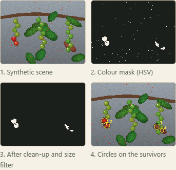
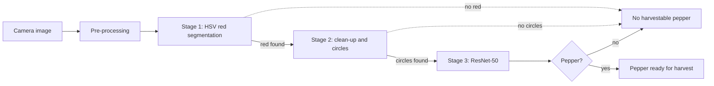

# Harvestable Black Pepper Recognition: an interactive explainer of a co-authored IEEE paper

[](https://creativecommons.org/licenses/by-nc-nd/4.0/)

## Overview

This repository is an independent, educational explainer of the published paper *Harvestable Black Pepper Recognition Using Computer Vision* (S. Joseph, N. F. Jane Rose and P. V. Akhil, ICACC 2019, IEEE). It explains in plain language how the paper recognises harvestable pepper: pre-processing, three gated stages ending in a ResNet-50 classifier, and how its "global accuracy" is defined. It also points out where the paper is unclear. **No code, data, images, figures, tables or text from the paper are included, and the paper's code and data are not released.** Every statement about the paper is traced to a paper page in [docs/runs/2026-10-14-paper-trace.md](docs/runs/2026-10-14-paper-trace.md).

## Demo

Live page: https://janeferdinant.github.io/black-pepper-recognition/ (GitHub Pages, served from the `docs/` folder of `main`). Or open `docs/index.html` in a browser (no build step, no network needed).



The page contains:

- the problem and a one-table summary of the paper with paper page numbers;
- a step-by-step walkthrough of the pipeline, and a gate explorer that applies the paper's go/stop logic to values you choose (including both readings of the stage-2 rule);
- an interactive colour-threshold and clean-up demo on generated synthetic images;
- how ResNet-50 is used in the paper, plus a panel on the standard public ResNet-50 architecture;
- the definition of "global accuracy", with a small arithmetic tool on example counts;
- the paper's reported result, shown as "Reported in the paper (not reproduced here)";
- limitations, future scope, and sources and gaps.

Anything that is not the paper's real operation carries the label **"Illustrative, not the paper's implementation"** (or "Illustrative counts, not the paper's results").

## Problem statement

Kerala is a major black-pepper region but not the largest producer. The authors link this in part to a shortage of skilled labour and to the difficulty of spotting harvestable pepper in time (paper p. 1). Their aim is to find harvestable pepper, and its position, in a photograph, for use in an automated harvesting drone (p. 1). The paper gives no formal definition of "harvestable"; its first stage looks for the red colour range.

## Approach

How the paper's method works, in our words (page numbers are the paper's):



- **Pre-processing** (p. 3-4): edge-preserving guided filtering, local Laplacian filtering for contrast, then histogram equalisation; the pseudo-code resizes input to 300 x 400 (p. 6).
- **Stage 1** (p. 1, 4): convert to HSV and keep the red range as the region of interest. HSV was preferred to RGB, YCbCr and L*a*b* because red and yellow separate well from green. Gate: no red, stop.
- **Stage 2** (p. 1, 5, 6): morphological operations remove small noise, objects under 60 pixels are dropped, the centroid of each remaining object gets a circle, and circles are counted. Gate: no circles, stop. *Unclear:* the prose says zero circles, the pseudo-code says one or fewer.
- **Stage 3** (p. 1, 5, 6): ResNet-50 gets the input image and answers pepper or not pepper. It was trained on more than 500 images from the new set. It was chosen over ResNet-101, GoogLeNet, AlexNet and an SVM-based classifier on accuracy and run time (p. 6). *Unclear:* whether the network was fine-tuned or used only for features.
- Moving to the next stage only when a condition is met is said to reduce processing time and computing resources (p. 2).

The demo cannot reproduce stages 1 to 3 without the paper's images and settings, so it shows generic versions of the stage-1 and stage-2 operations on synthetic images. No classifier runs.

## Data

- The paper introduces a new black-pepper image set captured with an ordinary digital camera in natural canopies in Kerala; ResNet-50 was trained on more than 500 of its images (p. 1, 5, 7). **It is not included here, and the paper does not say it is available.**
- Test set: 115 images, 65 with harvestable pepper and 50 without (p. 6-7). Whether test and training images are kept apart is not stated.
- The demo generates cartoon scenes in code (`generateScene` in `docs/js/imageproc.js`) from a numeric seed. They are original synthetic images, not derived from the paper's images.

## Results

| Metric | Value | Status | How measured | Date |
|---|---|---|---|---|
| Global accuracy (whole three-stage system) | 100% | Reported in the paper (p. 5-7). Not reproduced here | Share of 115 test images (65 with harvestable pepper, 50 without) the complete system classified correctly: 115 of 115; recall and precision both 100% | 2019 |
| Classifier-only accuracy | 96.35% (table) or 98.44% (text) | Reported in the paper (p. 5); the two figures conflict, see Limitations | Stage 3 alone, from a confusion matrix | 2019 |
| Unit tests for the helpers | 37 of 37 pass | Verified (run 2026-10-14) | `node --test`, log in [docs/runs/2026-10-14-checks.md](docs/runs/2026-10-14-checks.md) | 2026-10-14 |
| Page console errors at 390 px and 1280 px | 0 | Verified (run 2026-10-14) | Playwright, same log | 2026-10-14 |

The demos display no accuracy or other headline metric on images. They run no recognition model.

## Tech stack

Plain HTML, CSS and JavaScript (no framework, no build, no CDN). Tests use Node's built-in `node:test`. Browser checks used Playwright.

## Getting started

Prerequisites: Node.js 20 or later (tested with v22.20.0). Python 3 is optional, only for a local web server.

```bash
git clone https://github.com/Janeferdinant/black-pepper-recognition.git
cd black-pepper-recognition
node --test
```

Expected output ends with `# tests 37`, `# pass 37`, `# fail 0`.

To view the page, open `docs/index.html` directly, or serve it:

```bash
python -m http.server 8000 --directory docs
```

then browse to `http://localhost:8000/`.

## Project structure

```
docs/index.html            the explainer page
docs/js/imageproc.js       HSV, thresholding, morphology, connected components, synthetic scene generator
docs/js/paperlogic.js      gate logic, confusion-count metrics and circles, as the paper describes them
docs/js/app.js             page behaviour (stepper, gate explorer, demo, ResNet panel, arithmetic tool)
docs/runs/                 dated check logs, the paper trace, screenshots
tests/imageproc.test.js    node --test suite for the image helpers
tests/paperlogic.test.js   node --test suite for the gate and metric helpers
LICENSE                    CC BY-NC-ND 4.0
```

## Real-world applications

Selective harvesting of spice and fruit crops, yield monitoring, and ripeness grading are the settings where this kind of recognition is useful. The paper's own stated application is an automated harvesting drone (p. 1).

## Limitations

The paper has no limitations section. Its nearest statements are that a high-performance GPU and processor are desirable (p. 2-3) and its future-work list (p. 7).

Points a careful reader would raise (this explainer's notes, not the paper's):

- 115 test images is a modest sample. Zero errors in 115 trials is consistent with a true error rate up to about 2.6% (one-sided 95% bound, derived here, not from the paper).
- Whether test images overlap training images is not stated.
- Lighting, camera settings and other capture details are not given; one crop, one region.
- Two classifier-only accuracies (96.35% in the table, 98.44% in the text); the table figure matches the table's confusion matrix. The stage-2 gate differs between prose and pseudo-code. The printed accuracy formula lacks brackets.
- Fine-tuning versus feature extraction, input size and training settings are not stated.
- Speed is described as reasonable for real-time use but no end-to-end scan time is given.
- No released data or code, so the result cannot be re-run.
- 2019 methods; today's detectors and segmentation models are more direct.
- The demos here use cartoon images and generic techniques; they do not test or approximate the paper's results.

## Future scope

From the paper (p. 7): live video instead of stills; automatic cutting-point identification; ground or aerial vehicles with a cutting mechanism; a mobile app for farmers.

Suggestions of this explainer, not from the paper: modern detectors and instance segmentation; edge deployment with quantised models; evaluation across farms, seasons and lighting on a shared split with per-class precision and recall.

## Sources and gaps

Sources used:

- The published paper (a copy supplied by a co-author; it is not in this repository). Claim-to-page list: [docs/runs/2026-10-14-paper-trace.md](docs/runs/2026-10-14-paper-trace.md).
- Crossref record for DOI 10.1109/ICACC48162.2019.8986220 (author form, venue, pages, year). The conference name and city are not printed in the supplied copy.
- He, Zhang, Ren and Sun, "Deep Residual Learning for Image Recognition", CVPR 2016, DOI 10.1109/CVPR.2016.90, for the standard ResNet-50 architecture.

Still not answered by the paper:

1. A formal definition of "harvestable".
2. Whether the 500+ images are the whole set or the training part, the split, and any train/test overlap.
3. Capture details (lighting, camera model, resolution) and whether the set is available.
4. Whether ResNet-50 was fine-tuned or used for features, its input size, and training settings.
5. Which stage-2 rule was actually run, and the exact red range.
6. An end-to-end scan time.
7. Which of 98.44% and 96.35% is the classifier-only accuracy.

## Credits & citation

Paper: S. Joseph, N. F. Jane Rose and P. V. Akhil, "Harvestable Black Pepper Recognition Using Computer Vision," *2019 9th International Conference on Advances in Computing and Communication (ICACC)*, Kochi, India, IEEE, 2019, pp. 97-102. DOI: [10.1109/ICACC48162.2019.8986220](https://doi.org/10.1109/ICACC48162.2019.8986220). (The paper's title page gives the third author as Akhil Vijayan.)

Credit for the paper belongs to all three authors: Shelbi Joseph, N. F. Jane Rose (Jane Rose Ferdinant) and P. V. Akhil. This explainer is independent and is not affiliated with or endorsed by IEEE or the conference. It explains the published method only; the paper's code and data are not released and none is included.

## License

Original work © Jane Rose Ferdinant, licensed [CC BY-NC-ND 4.0](https://creativecommons.org/licenses/by-nc-nd/4.0/). See `LICENSE`. The paper itself is copyrighted by its publisher and authors and is not part of this repository.

## Author

Jane Rose Ferdinant: [portfolio](https://janeferdinant.vercel.app) · [LinkedIn](https://www.linkedin.com/in/janerosenf/)
